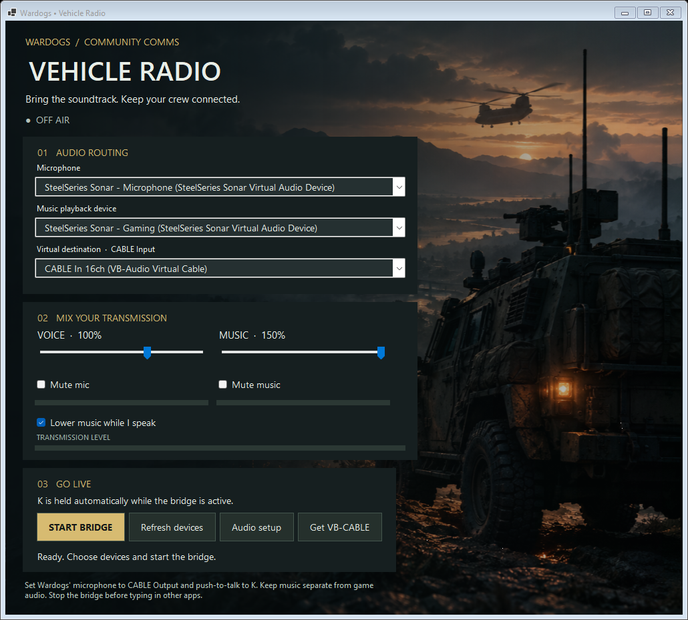

# Wardogs Vehicle Radio

A Windows desktop app that combines a physical microphone with music playing on a selectable Windows audio output, then sends the mix to a virtual cable for in-game voice chat. Independent volume/mute controls, speech ducking, meters, saved device selections and a clipping guard are included.



Download the Windows x64 portable ZIP from this repository's **Releases** page. Extract the entire ZIP, then run `WardogsBridge.exe`.

## First run

1. Download **VB-CABLE** from https://vb-audio.com/Cable/. Extract it, run the vendor's setup as administrator, and restart Windows. The app does not install or bundle third-party drivers.
2. Run `WardogsBridge.exe` from the portable release folder.
3. Select your physical microphone, the device Spotify plays through, and **CABLE Input (VB-Audio Virtual Cable)** as the bridge destination.
4. Start the bridge. In Wardogs select **CABLE Output (VB-Audio Virtual Cable)** as the microphone. If the game only uses the Windows default communications input, set CABLE Output there through Windows Sound settings.
5. Set Wardogs' push-to-talk binding to **K**. Start the bridge, return to the game, play music and speak. The app holds K continuously while active and releases it when stopped, on audio failure, or on normal close. Start with music at 30%. Music mute keeps voice working; Stop cuts both signals and releases K.

## Automatic push-to-talk

The bridge sends physical K key-down events through Windows SendInput and renews them while active so returning to the game engages push-to-talk. It sends key-up when deactivated. **Stop the bridge before typing in other apps**, because the held key applies to the foreground window. Run the app and game at the same Windows permission level. Some games may reject simulated input; verify K transmission in Wardogs. This utility does not bypass input restrictions. If the process is forcibly killed or Windows crashes, automatic cleanup cannot run; press and release K manually if needed.

Implementation reference: https://learn.microsoft.com/en-us/windows/win32/api/winuser/nf-winuser-sendinput

The cable names are from the cable's perspective: the app writes to CABLE **Input**, and the game records CABLE **Output**. Keep normal Windows playback on your headphones, not on the destination cable.

## Music isolation and listening

This version captures a **playback device**, not a single process. Every sound on that device is included. For music-only transmission, route Spotify to a separate playback endpoint using Windows Settings → System → Sound → Volume mixer (Audio setup opens it). Keep Wardogs, incoming voice chat, and notifications on another endpoint. Two independent physical outputs or an additional virtual cable can provide this separation.

With a second virtual cable, route Spotify to that cable's playback Input and select it as the music source. In Windows Sound → Recording → that second cable's Output → Properties → Listen, send it to your headphones if you want to hear it locally. Do not enable Listen on the game's destination cable back into the selected music source, as this creates feedback. The app prevents using the same playback device as source and destination and blocks cable microphones.

Use headphones to avoid acoustic feedback. Bind the game's push-to-talk to K for automatic transmission. Game noise suppression/voice processing may suppress music; adjust those settings if available. The app cannot override the game's voice channel, proximity rules or vehicle behavior.

## Troubleshooting

- No cable listed: install/reboot, then Refresh devices. VB-CABLE and VoiceMeeter playback destinations are detected by name.
- No mic meter: verify Windows microphone permissions and the physical input selection.
- No music meter: select the endpoint Spotify actually uses and play a track.
- Both meters move but players hear nothing: check the game's cable recording selection and transmission settings. Test CABLE Output with Windows' recorder first.
- Device unplugged or audio stopped: the bridge stops with an error; reconnect, refresh and start again.
- Game audio is being transmitted: separate music and game playback devices as described above.
- Latency depends on the hardware, shared-mode WASAPI and the cable driver. Buffers are bounded and stale capture packets are discarded after stalls.

## Build and verify

Requires the .NET 10 SDK on Windows. Audio uses NAudio 2.2.1.

```powershell
dotnet restore src/WardogsBridge --configfile NuGet.Config --packages .packages
dotnet build src/WardogsBridge -c Release --no-restore
dotnet run --project src/WardogsBridge -c Release --no-build -- --self-test "$PWD\self-test.txt"
dotnet publish src/WardogsBridge -c Release -r win-x64 --self-contained true -o dist/WardogsBridge
```

Self-test checks signal mixing, mute independence, silence on underrun, ducking, clipping protection, K down/renew/release lifecycles with an injected test sender, native keyboard-event layout, and form rendering. It lists audio endpoints but does not send actual keys or prove end-to-end game transmission. Real microphone → cable → recorder → Wardogs testing is required before a community release.

## Artwork

`src/WardogsBridge/Assets/vehicle-radio.png` is embedded in the executable. Original artwork generated with the built-in imagegen tool. Prompt: cinematic realistic military game concept art; armored utility vehicle on the right of a misty dusk battlefield, distant transport helicopter, dark charcoal/olive/smoky teal, warm amber lights, left two-thirds dark and low detail for controls; no text, logos, watermark, UI or gore.

## Sharing

Share the portable release ZIP and this guide. The Windows x64 build includes its .NET runtime. Each recipient installs VB-CABLE separately from the vendor. NAudio is MIT licensed; its license is included in the release. This is an unofficial community utility with no game or Spotify affiliation. The app does not access Spotify accounts or change system audio defaults.

## License

Licensed under the **Apache License 2.0**. See [LICENSE](LICENSE) and [NOTICE](NOTICE). Third-party components retain their own licenses; see [THIRD-PARTY-NOTICES.txt](THIRD-PARTY-NOTICES.txt). VB-CABLE is installed separately and is not included in the repository or release.
